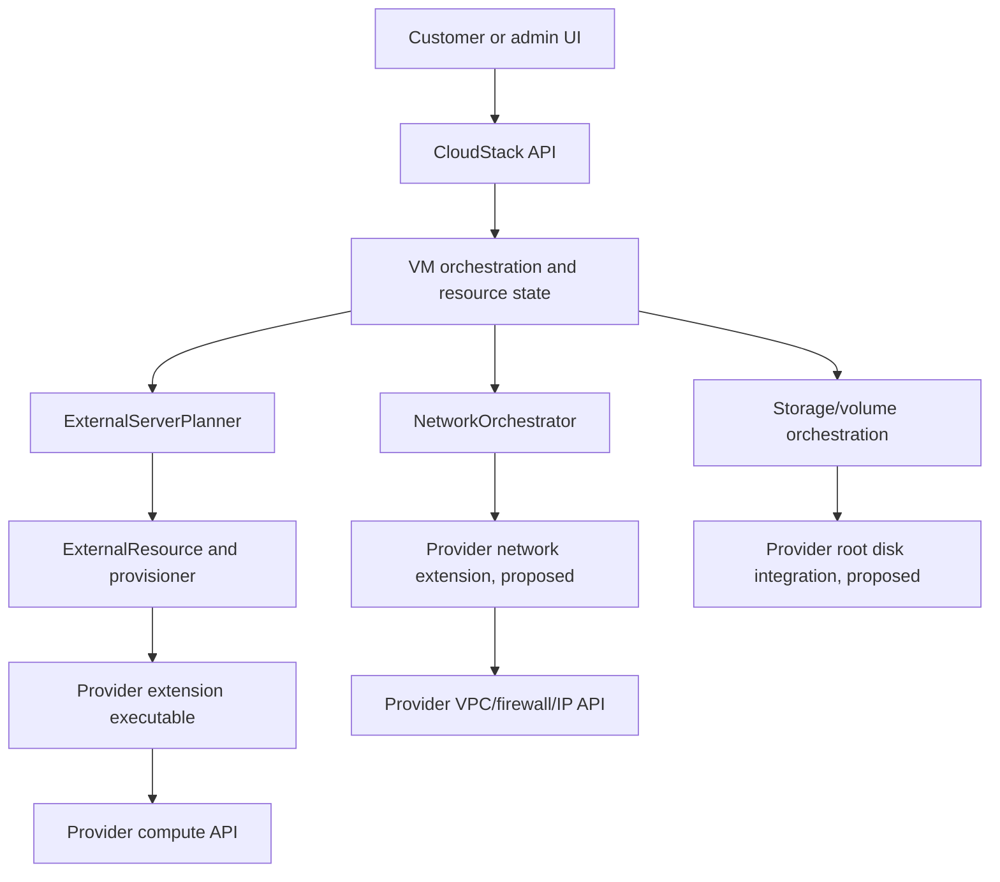

# Architecture map: provider-backed VMs

**Classification:** verified repository structure + conceptual integration path. This is **not** a runtime-verified call graph. [SKY-001](https://github.com/SkyMoonTechnologies/cloud/issues/3) owns proving the exact sequence, state transitions and actual persistence behavior.

## Existing building blocks

| Logical layer | Where to investigate | Known responsibility |
| --- | --- | --- |
| Web UI | `ui/src/views/` and `ui/src/views/infra/zone/ZoneWizard*.vue` | CloudStack API-driven VM/zone administration. |
| Management API | `api/src/main/java/org/apache/cloudstack/api/command/` | Commands such as VM deployment and zone creation. |
| VM control | `server/src/main/java/com/cloud/vm/UserVmManagerImpl.java` | User instance operations. |
| Placement | `plugins/hypervisors/external/src/main/java/org/apache/cloudstack/agent/manager/ExternalServerPlanner.java` | Chooses an eligible External cluster/host for applicable VM/template requests. |
| Template integration | `plugins/hypervisors/external/src/main/java/org/apache/cloudstack/agent/manager/ExternalTemplateAdapter.java` | Handles External template registration. |
| Hypervisor bridge | `plugins/hypervisors/external/src/main/java/org/apache/cloudstack/hypervisor/external/resource/ExternalResource.java` | Bridges VM commands into External provisioner operations. |
| External executable | `plugins/hypervisors/external/src/main/java/org/apache/cloudstack/hypervisor/external/provisioner/ExternalPathPayloadProvisioner.java` | Executes extension entry points with JSON payloads and action names. |
| Network orchestration | `framework/extensions/src/main/java/org/apache/cloudstack/framework/extensions/network/NetworkExtensionElement.java` | Network extension commands including network/NIC/IP/firewall operations. |
| Storage | `engine/orchestration/src/main/java/org/apache/cloudstack/engine/orchestration/{StorageOrchestrator,VolumeOrchestrator}.java` | Existing storage and volume lifecycle, whose assumptions must be investigated. |
| Zone creation | `server/src/main/java/com/cloud/configuration/ConfigurationManagerImpl.java` and `ui/src/views/infra/zone/ZoneWizardLaunchZone.vue` | Conventional zone/pod/networks and wizard launch; not provider-only today. |

## Conceptual sequence (must be verified in SKY-001)



**Solid arrows represent intended system responsibilities, not traced execution order.** Networking and root disk integration on the right are work items, not established production paths.

### Current extension invocation interface

`ExternalPathPayloadProvisioner.executeExternalCommand` runs an executable in the extension directory with:

```text
<entry-point> <action> <JSON-payload-file> <timeout-seconds>
```

Observed in repository code: file-executable check, process timeout, captured combined output, exit-code handling. Relevant existing VM actions include `prepare`, `create`, `start`, `stop`, `reboot`, `status`, `statuses`, and `delete`. Verify action-specific response contracts from Java and sample extensions rather than assuming a generic JSON success body is accepted.

`NetworkExtensionElement` separately exposes network-oriented actions such as `implement-network`, `destroy-network`, `assign-ip`, `release-ip`, `prepare-nic`, `release-nic`, `apply-fw-rules` and others. **Do not** assume every provider supports all actions.

## Important current gaps

- The zone wizard currently asks for CloudStack-owned public IP pools and creates conventional networking/host/storage resources. The current design cannot simply substitute a DigitalOcean VPC CIDR for them.
- `ConfigurationManagerImpl` uses non-Edge pod validation that expects conventional networking; an explicit opt-in provider-managed branch is proposed.
- `ZoneWizardLaunchZone.vue` currently launches primary storage setup after host registration in its conventional workflow.
- CloudStack and the provider can allocate different identifiers, NICs and public IPs, so create/reconcile/delete must be idempotent and safely mapped.
- Java's VM-create response handling and the provider's asynchronous action semantics must be verified together.
- The `SKY-EPIC-001` issue backlog is a **proposal**, not proof that these hooks are sufficient.

## Ownership boundaries

| SkyMoon logical responsibility | Physical provider responsibility |
| --- | --- |
| Customer/tenant authorization, product/plan selections, SkyMoon resource ID, desired state, pricing and audits | Actual Droplet/server ID, compute placement, provider root disk, VPC/assigned IPs, cloud firewall API |
| Capability gating, asynchronous orchestration, retry/reconciliation and customer-facing API | Provider capacity, native lifecycle API behavior and provider-side billing |
| Safe deletion semantics, provider account scoping and reconciliation | Enforcing provider resources only for credentials and regions explicitly granted |

For self-operated regions, KVM/CloudStack may continue performing physical responsibilities. Do **not** change default Core/KVM code paths to make provider-managed resources work.

## Research checklist for SKY-001

- Determine exact API method and command classes for deployment and destruction.
- Record which component creates VM, NIC, volume, network and state rows, with before/after transaction boundaries.
- Trace prepare/create/status/stop/delete response parsing and failure semantics in Java.
- Show where the extension ID is selected from template/cluster and where the host/cluster/zone is validated.
- Trace system VM and storage pool requirements, distinguishing unconditional checks from conditional calls.
- Capture one **mocked or isolated** deployment trace and document paths, method names and failure edges.

Link the verified call graph and test evidence back to SKY-001 and update this page when claims become proven.
